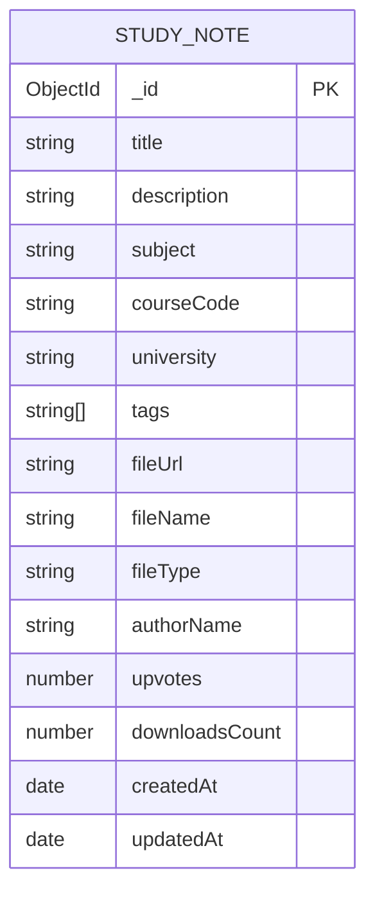

# StudyMate Hub

StudyMate Hub is a course-note sharing application built as a MERN-style mini project: MongoDB stores study notes, Express and Node.js provide a REST API, and React with Vite powers the responsive interface.

## Requirements

- Node.js 20.19 or newer (or 22.12 or newer) and npm
- MongoDB Community Server running locally

## Run locally

1. Install the project dependencies from the repository root:

   ```powershell
   npm install
   ```

2. Copy the sample server configuration and keep the copy local:

   ```powershell
   Copy-Item .env.example server\.env
   ```

   The default `MONGODB_URI` points to `mongodb://127.0.0.1:27017/studymate`. The example file contains no credentials. Do not commit `server/.env`.

3. Start MongoDB. If the MongoDB service is not already running, open a separate terminal from the repository root:

   ```powershell
   New-Item -ItemType Directory -Force .data\mongodb
   mongod --dbpath .data\mongodb --bind_ip 127.0.0.1
   ```

4. Start the API and frontend from the repository root:

   ```powershell
   npm run dev
   ```

5. Open `http://localhost:5173`. The API runs on `http://127.0.0.1:5000`; Vite proxies `/api` requests to it. On startup, existing legacy StudyMate notes are migrated in place to the current note schema without deleting them. On the first connection to an empty database, four sample notes are inserted. Set `SEED_DEMO_DATA=false` in `server/.env` to disable this for a clean database.

## Study-note operations

The Study Notes collection is the main project entity and has persistent, database-backed CRUD:

| Operation | Interface | API |
| --- | --- | --- |
| Create | Share a note form | `POST /api/notes` |
| Read | Note list and detail dialog | `GET /api/notes`, `GET /api/notes/:id` |
| Update | Edit note form | `PUT /api/notes/:id` |
| Delete | Confirmed delete action | `DELETE /api/notes/:id` |

The directory supports text search, subject filtering, and sorting by recent, popularity, downloads, or title. Server-side Zod validation rejects incomplete, oversized, or unexpected input. The API returns explicit 400 and 404 responses for invalid data and identifiers.

This local classroom demo does not include sign-in, authorization, or binary file uploads. It stores note metadata and optional public resource links. Do not expose the development API to the public internet or use real private student data.

## Interface preview


The original Next.js routes and Firebase modules remain in the repository as reference material; the runnable MERN implementation is in `client/` and `server/`.

## Database design

`studymate.notes` is a MongoDB collection. MongoDB assigns each note an `_id` ObjectId primary key. Timestamps are maintained by Mongoose. The sample notes have no required relationship to another collection, keeping CRUD independently demonstrable.



Indexes support newest-first listing, and a MongoDB text index is defined for the note content fields. The directory uses escaped, case-insensitive substring matching across titles, descriptions, subjects, course codes, and tags. The UI displays required fields, subject/course details, tags, preview text, contributor, and timestamps.

## Validation and errors

- Client-side HTML constraints provide immediate feedback for required and bounded-length fields.
- The API applies a strict Zod schema and rejects unknown properties, unsafe file URL protocols, invalid note data, and more than ten tags.
- Invalid input and IDs return a 400 response; missing notes return 404.
- The app shows loading, empty, API error, save, and delete states. Deletion requires confirmation.
- `/api/health` reports API and MongoDB connection status.

## Verification

From the repository root:

```powershell
npm test
npm run typecheck
npm run build
```

The API tests cover input trimming, required fields, unexpected properties, URL schemes, and tag limits. For a presentation, also demonstrate create → refresh the browser → read → edit → refresh → delete, then show the MongoDB collection and the validation response for an invalid request.

## Rubric coverage checklist

| Rubric area | Evidence in the project |
| --- | --- |
| Create / Read / Update / Delete | Working persistent note forms, list/details, edits, confirmed deletes, and REST endpoints |
| Validation / error handling | Browser constraints, strict server validation, API errors, loading/retry states |
| Database design | Mongoose schema, ObjectId key, timestamps, indexes, and ER diagram above |
| UI / UX | Responsive notes dashboard, search, subject filters, sorting, dialogs, and empty/loading/error states |
| Code quality / version control | Separate client and server workspaces, reusable API/form components, and Git repository |
| Documentation | Setup steps, API map, database diagram, verification commands, and demo checklist |
| Demonstration | Suggested live workflow: show the list, create, read, update, refresh to prove persistence, delete, and validation |

Capture original screenshots of the running application for the final report. Personalize the report and presentation, and be prepared to explain the schema, validation, API routes, and React state flow.
